# Scoutly

Find internships anywhere in the world, matched to your resume and availability. Ranked listings from public job-board APIs, availability and city filters, a map, and an application tracker. **Your resume never leaves your browser.**

> Portfolio project by Shriyank Reddy Singireddy (Computer Science, Arizona State University).

**Live site:** _add the GitHub Pages URL here once Pages is enabled_ (`https://<user>.github.io/Scoutly/`)

> **Data status:** until the first scheduled data refresh succeeds on GitHub, the site shows clearly labelled **sample data** (fictional companies). Every number the site shows (counts, "Updated …") comes from real pipeline output in `meta.json`; none are quoted in this README.

## Screenshots

Captured from the sample data (fictional listings). Full set in [`docs/screenshots/`](docs/screenshots/), desktop at 1440 px and phone at 390 px, both 2x.

| Screen                            | Desktop                                        | Phone                                        |
| --------------------------------- | ---------------------------------------------- | -------------------------------------------- |
| Start: resume drop zone           | 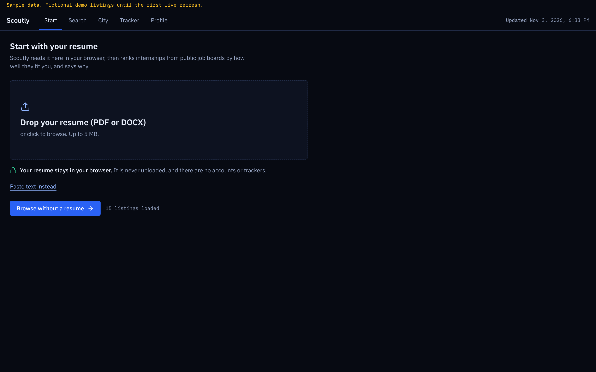         | 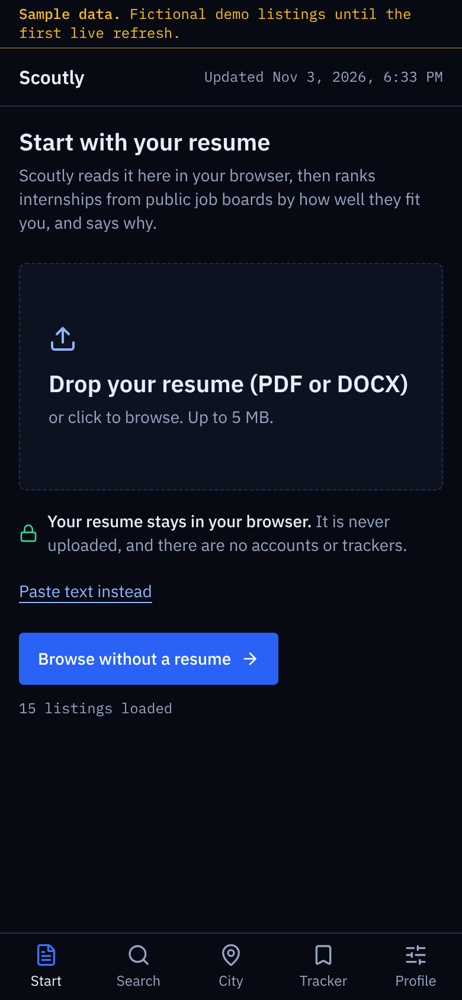         |
| Extracted profile, editable       | 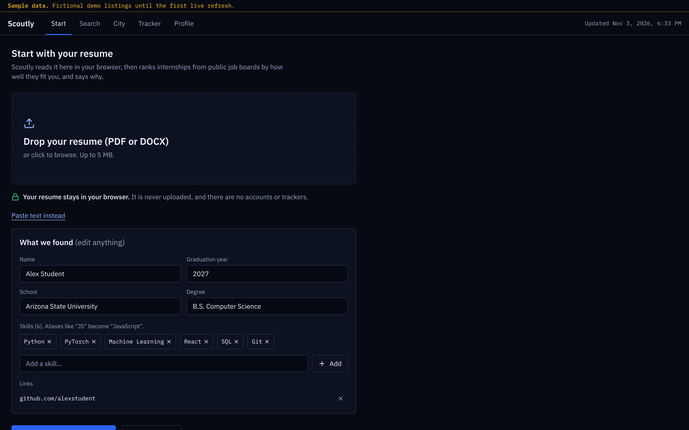 | 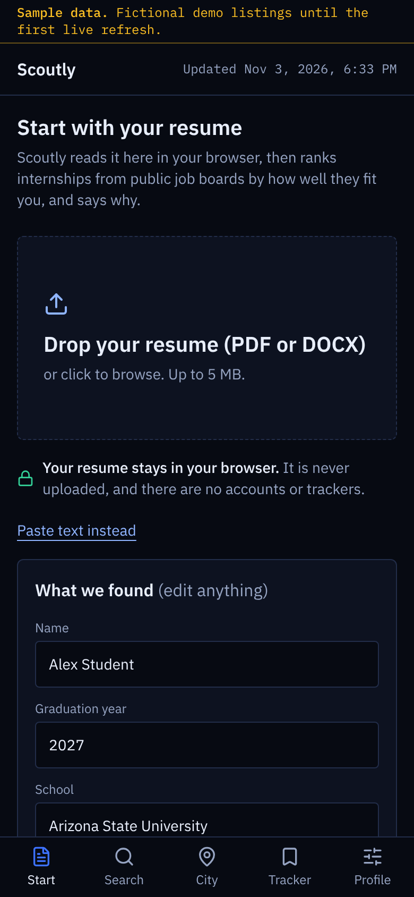 |
| Ranked search                     | 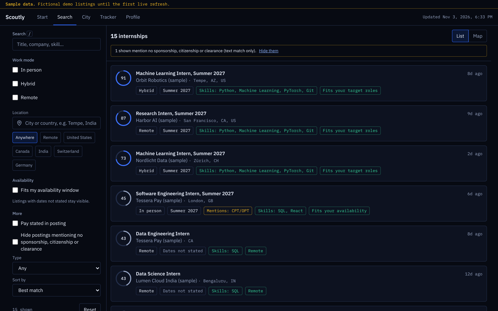       | 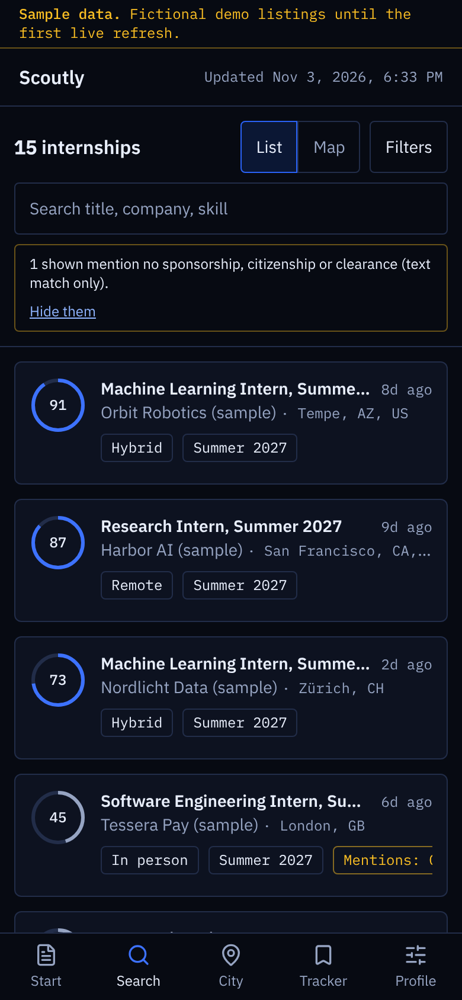       |
| Listing detail and why it matched | 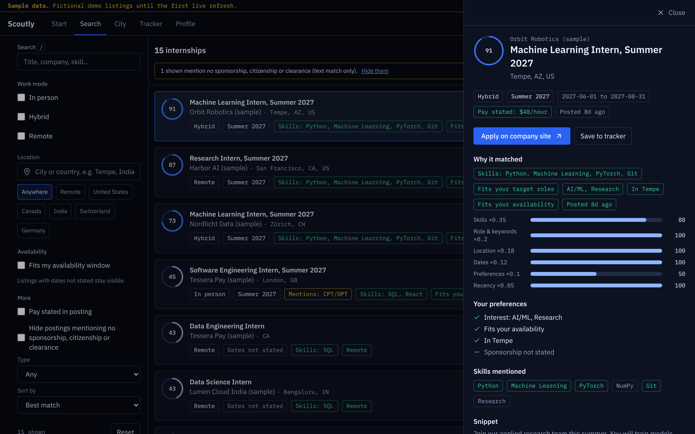       | 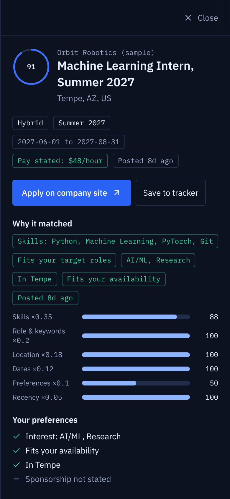       |
| Filters (bottom sheet on phone)   |                                                | 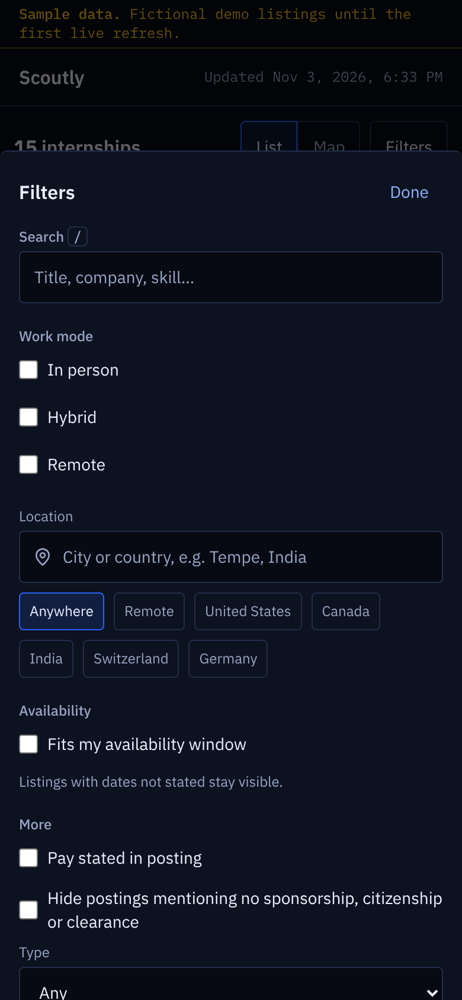      |
| City view                         | 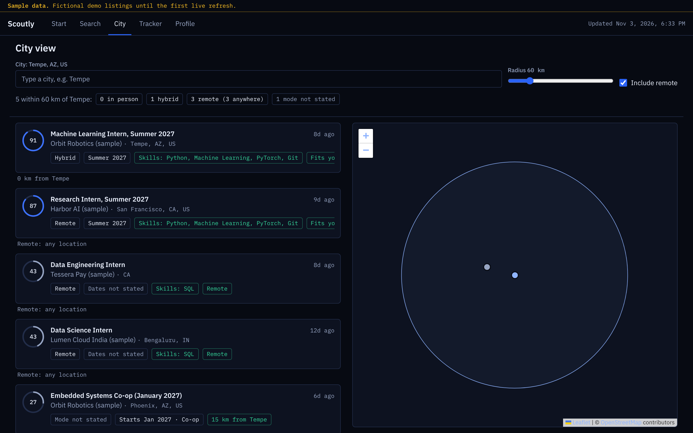         | 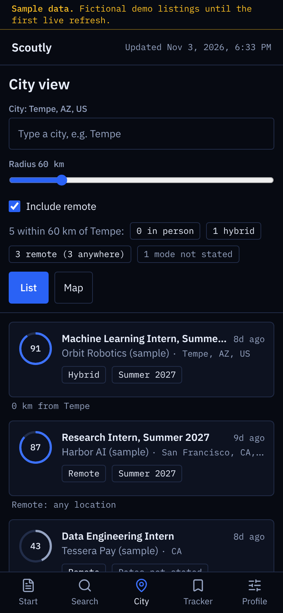         |
| Preferences                       | 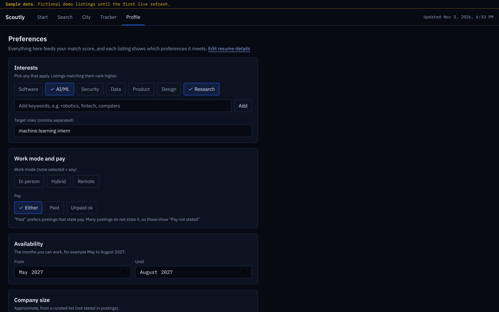  | 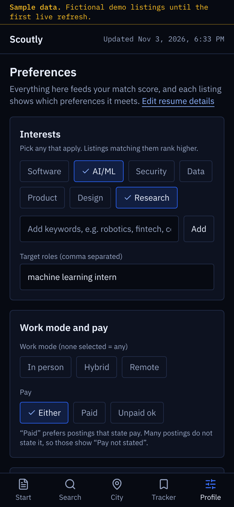  |

Map tiles are blank in these captures because the capture environment had no access to OpenStreetMap; pins and the radius circle are real. Retake the city view on the live site.

## Features

- **Resume first**: the home page is a drop zone for a PDF/DOCX (or pasted text), with parse progress and an editable summary of the skills, school, graduation year and links found.
- **Personalised**: interest chips, keywords, work mode, pay, availability months, company size and sponsorship/CPT preferences all feed the score, and each listing shows which of them it meets.
- **Ranked search** with a short "why it matched" on every result (skills, location, dates).
- **Availability**: each listing is tagged with its season/dates _only when the posting states them_ (Summer 2027, co-op, part-time). Unknown dates show "Dates not stated" and are never hidden or guessed.
- **Location search**: one box with offline autocomplete for several cities and countries, a radius slider, and Remote / Anywhere chips; list, map and URL update together.
- **City view**: pick any city and radius; list and map stay in sync, with in-person / hybrid / remote clearly marked.
- **Search elsewhere**: pre-filled "Search on LinkedIn / Internshala / Handshake / Indeed" links (plain links; Scoutly never scrapes them), and **Add from link** in the tracker for postings found anywhere.
- **Tracker**: Saved → Applied → Interviewing → Offer → Rejected, notes, follow-up dates, CSV export.
- **Work-authorization flags**: postings mentioning citizenship, "no sponsorship", security clearance or CPT/OPT get a "Mentions: …" badge. These are text matches, not legal advice.
- Keyboard shortcuts (`/` search, `j`/`k` move through results, `Esc` close), skeleton loaders, reduced-motion support.

## How matching works (plain words)

Every listing gets six sub-scores between 0 and 1, which are combined with fixed weights (set in `src/config/weights.ts`):

| Part                       | Weight | In plain words                                                                                                                     |
| -------------------------- | ------ | ---------------------------------------------------------------------------------------------------------------------------------- |
| Skills                     | 0.35   | How many of the skills the posting mentions are on your profile (common skills like Git count half)                                |
| Role, keywords & interests | 0.20   | BM25 text similarity to your target roles and keywords, blended with the interest chips you toggled (Software, AI/ML, Security, …) |
| Location                   | 0.18   | Remote if you allow it, otherwise distance to your preferred cities vs your radius; a work mode you did not pick is down-weighted  |
| Dates                      | 0.12   | Overlap between your availability months and the posting's dates                                                                   |
| Preferences                | 0.10   | Pay, company size (approximate, curated) and sponsorship / CPT-friendly text                                                       |
| Recency                    | 0.05   | Newer postings first                                                                                                               |

When something is unknown (e.g. no dates in the posting) that part gets a neutral 0.5 instead of a penalty. The detail drawer shows each part. Nothing calls an LLM or any paid API; it all runs in your browser.

## Privacy

Your resume and profile are parsed and stored **only in your browser** (localStorage on your device). They are never uploaded. There are no accounts, no analytics and no trackers. The Profile page has a **Delete all my data** button.

The only network requests are for the site's own files, the Google Fonts stylesheet, and OpenStreetMap map tiles when you open a map.

## Data sources and attribution

Listings come from the public job-board APIs that companies publish for their own listings (**Greenhouse**, **Lever**, **Ashby**) and, as second-hand copies that lose to the company's own listing when duplicated, from **[Jobs by Adzuna](https://www.adzuna.com)** (needs a free key; skipped if absent), **[Remotive](https://remotive.com)** and **[Arbeitnow](https://www.arbeitnow.com)**. Aggregator listings are labelled "via <source>". Only a short snippet is stored and every listing links to the original posting. Details, endpoints and how terms are respected: [docs/DATA_SOURCES.md](docs/DATA_SOURCES.md).

- City data: [GeoNames](https://www.geonames.org), CC BY 4.0.
- Map: © [OpenStreetMap](https://www.openstreetmap.org/copyright) contributors, via [Leaflet](https://leafletjs.com).

## Run locally

```bash
npm ci
npm run fetch-jobs -- --fixtures   # offline: build sample data from recorded-shape fixtures
npm run dev                        # http://localhost:5173
```

```bash
npm run fetch-jobs   # live fetch of the boards in data/companies.json (falls back to sample data if offline)
npm test             # Vitest
npm run lint && npm run typecheck && npm run build
npm run e2e          # Playwright smoke test (needs `npm run preview -- --port 4173` running)
```

Deploy: enable Pages (Settings → Pages → Source: GitHub Actions), then run the **Refresh data** workflow once. See [STATUS.md](STATUS.md).

## Limitations

- Coverage is limited to companies that publish boards on Greenhouse, Lever or Ashby, and to the curated list in `data/companies.json`. Many companies and regions are missing, and the seed slugs still need verification.
- Dates and pay are shown only when postings state them; most postings do not.
- Location parsing is heuristic and only geocodes cities in the bundled list (≈3.8k cities); small towns have no map pin.
- Work-authorization flags are text matches, not legal advice. Always read the posting and ask the employer.
- Resume parsing is rule-based and can miss or mislabel items; review the extracted profile.

## Docs

[Architecture](docs/ARCHITECTURE.md) · [Data sources](docs/DATA_SOURCES.md) · [Decisions](docs/DECISIONS.md) · [Learning guide](docs/LEARNING.md)

## License

MIT, © Shriyank Reddy Singireddy.
